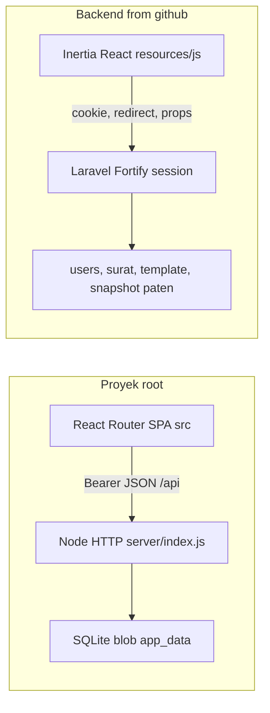

# Analisis ulang SIMPEL setelah backend kelompok diperbarui

Salinan di [Backend from github](Backend%20from%20github) diganti sekaligus pada 12 Nov 2026 pukul 09.23, termasuk `simpel-gladagsari-main.zip`. Isi route, model, dan controller dicek ulang. Proyek root tidak berubah.

Keduanya tetap produk yang sama: layanan Kecamatan Gladagsari untuk surat dispensasi nikah, registrasi paten, dan manajemen pegawai. Saran temanmu benar arahnya hanya jika kelompok sepakat Laravel sebagai sumber data. Folder itu bukan API yang bisa disambungkan ke frontendmu.

## Proyek root milikmu

Stack: React 18, Vite, React Router, Node `http` bawaan, SQLite lewat `node:sqlite`. Satu perintah `npm run dev` menjalankan UI di port 5173 dan API di 3001. Akun demo login dengan NIP.

Data aplikasi disimpan sebagai dokumen JSON di tabel `app_data`: `riwayat`, `desa`, `dukuhByDesa`, `template`, `draft`, `sheets`. Pegawai punya tabel sendiri. Kontrak yang dipakai UI ada di [src/lib/api.js](src/lib/api.js) dan [server/index.js](server/index.js):

- `POST /api/auth/login` dengan `{ nip, password }`, balasan `{ token, user }` atau `{ needsCode, pendingToken }`
- `POST /api/auth/verify` menerima kode 6 digit apa pun
- `GET /api/auth/me`, `POST /api/auth/logout`, `PUT /api/profile`
- `GET /api/data` lalu `PUT /api/data/{resource}` untuk seluruh daftar sekaligus
- Lupa dan reset password mengembalikan 503

Peran di UI: `Pelayanan` dan `Administrator`. Riwayat menyimpan field form bahasa Indonesia (`nomorUrut`, `namaPemohon`, `tanggalNikah`) plus `nomorSurat` yang dibentuk di [src/pages/pelayanan/Editor.jsx](src/pages/pelayanan/Editor.jsx) sebagai `474.2/{nomorUrut}/6.20/{tahun}`. Desa bawaan hanya mengisi dukuh Candisari. Template pejabat masih placeholder, jabatan `CAMAT GLADAGSARI`.

**Kelebihan**

- UI mengikuti alur Figma: login NIP, kode autentikasi, editor surat, riwayat, desa/dukuh, template, paten, pegawai, profil.
- Kontrak JSON-nya eksplisit, jadi frontend dan server terpisah dengan jelas.
- Password di-hash dengan scrypt, token sesi disimpan sebagai hash, akun nonaktif ditolak, akun yang sedang dipakai tidak bisa menghapus dirinya.
- Desa dan dukuh tersimpan di database, bukan hanya di browser.
- Mudah dijalankan: Node saja, tanpa PHP.

**Kekurangan**

- `riwayat` dan `sheets` ditulis ulang sebagai satu blob. Tidak ada pencarian, filter tanggal, atau paginasi di database. Dua pengguna yang menyimpan bersamaan saling menimpa.
- `PUT /api/data/{resource}` tidak memeriksa peran, kecuali `pegawai`. Akun Pelayanan bisa menimpa template, riwayat, dan data desa.
- Daftar pegawai dikirim utuh dari browser. Server mempercayai isi daftar itu.
- Kode 6 digit apa pun lolos. Reset password belum ada.
- Ekspor "Excel" sebenarnya CSV di [src/lib/csv.js](src/lib/csv.js).
- Tidak ada tes otomatis. Akun demo dan password tertanam di kode server.
- Data dukuh bawaan tidak selengkap daftar di backend kelompok.

## Backend kelompok, salinan terbaru

Stack tidak berubah: PHP 8.3, Laravel 13, Inertia 3, React 19, Fortify, Tailwind, Pest, PHPStan, PhpSpreadsheet, editor Univer. Deploy tetap lewat [vercel.json](Backend%20from%20github/vercel.json). Route tetap di [routes/web.php](Backend%20from%20github/routes/web.php). Tetap tidak ada `routes/api.php` dan tidak ada Sanctum.

Auth memakai sesi cookie. Login menerima email atau NIP di [FortifyServiceProvider.php](Backend%20from%20github/app/Providers/FortifyServiceProvider.php). Peran: `administrator` dan `service`. Status: `active` / `inactive`. Fortify yang aktif: reset password, verifikasi email, TOTP. Akun baru selalu `service`. Administrator tidak bisa dihapus dan tidak bisa diberi 2FA.

Surat dispensasi tetap satu baris per `marriage_dispensations`. Template kop surat per kunci di `template_settings`. Paten tetap satu JSON snapshot Univer, ditambah snapshot template. Satu-satunya respons JSON di fitur layanan adalah simpan paten dan ambil snapshot template. Keduanya tetap butuh cookie sesi dan token CSRF, bukan header `Authorization: Bearer`.

**Kelebihan yang tetap, plus yang lebih jelas di salinan ini**

- Surat relasional: simpan, cari, filter tanggal, paginasi 15 baris, hapus, muat kembali ke editor.
- Ekspor riwayat `.xlsx` sungguhan. Editor paten juga impor/ekspor xlsx di browser lewat ExcelJS dan Univer.
- Validasi user, batas peran, rate limit login, TOTP Fortify, tes autentikasi Pest.
- Kunci template dibatasi di server.
- [template-settings.js](Backend%20from%20github/resources/js/lib/template-settings.js) sudah berisi data pejabat nyata: Gilang Pamungkas, Kasi Pelayanan, NIP, pangkat. Kop alamat sama dengan default milikmu.
- [village-data.js](Backend%20from%20github/resources/js/lib/village-data.js) berisi 10 desa beserta dukuhnya, lebih lengkap daripada seed Candisari di proyekmu.
- Seeder riwayat berisi 26 surat contoh. Rumus nomor di pratinjau surat sama dengan milikmu: `474.2/{nomor urut}/6.20/{tahun}` di [letter-preview.jsx](Backend%20from%20github/resources/js/components/letter-preview.jsx).

**Kekurangan yang tetap ada**

- Bukan API. Hampir semua aksi mengembalikan halaman Inertia atau redirect `back()`. Frontendmu tidak bisa memanggilnya dengan `fetch` JSON.
- Desa/dukuh hanya `localStorage`. Ganti browser berarti data hilang. Di proyekmu ini justru ada di SQLite.
- Semua kolom surat `nullable`, jadi surat kosong bisa tersimpan.
- NIP user tidak dibatasi 18 digit. Seeder admin (`administrator@gladagsari.go.id` / `password`) dan service tidak mengisi NIP.
- Seeder riwayat menulis nomor lengkap (`474.2/156/6.20/2026`) ke `letter_number`, sedangkan form dan pratinjau menganggap field itu nomor urut. Surat hasil seed akan tampil dengan nomor ganda kalau dibuka lagi di editor.
- [PatenSpreadsheetService.php](Backend%20from%20github/app/Services/PatenSpreadsheetService.php) tidak dipanggil siapa pun. Penyimpanan paten yang benar-benar jalan tetap blob snapshot Univer, sama rentan tertimpa seperti `sheets` milikmu.
- Ada frontend kedua di `resources/js`. Dua UI untuk fitur yang sama akan bentrok kalau keduanya dipertahankan.

## Yang tidak cocok jika disambungkan langsung

- Auth: Bearer token dan peran `Pelayanan`/`Administrator` versus cookie Fortify dan peran `service`/`administrator`.
- Bentuk data: satu `PUT /api/data/riwayat` berisi seluruh array versus `POST /marriage-dispensation` berisi satu record. Nama field Inggris (`applicantName`) versus Indonesia (`namaPemohon`).
- Nomor surat rumusnya sama, tetapi milikmu menyimpan nomor jadi dan field form bersama-sama. Laravel hanya menyimpan `letter_number`, dan isi seeder tidak konsisten dengan isi form.
- 2FA: milikmu menerima angka apa pun. Laravel menolak kode yang bukan TOTP.
- Paten: grid 5x5 versus snapshot Univer. File editor tidak saling baca.
- Desa: milikmu `{ desa: string[], dukuhByDesa }` di database. Kelompok `{ id, name, subvillages[] }` hanya di browser, tetapi isinya lebih lengkap.
- Template: struktur kunci kop surat hampir sama, tetapi nilai pejabat berbeda (placeholder milikmu versus data Gilang di kelompok).

## Insight

Pembaruan temanmu tidak mengubah bentuk kerjanya. Yang layak diambil dari masing-masing sisi:

- Dari proyekmu: halaman dan alur Figma di `src/`, plus desa/dukuh yang tersimpan di server.
- Dari kelompok: tabel surat, filter, ekspor Excel, Fortify, middleware peran, tes, daftar dukuh yang lengkap, dan default pejabat yang sudah terisi.

Jangan mengganti [server/index.js](server/index.js) dengan Laravel lalu mengharapkan [src/lib/api.js](src/lib/api.js) tetap jalan. Laravel perlu lapisan JSON yang meniru kontrak `/api` milikmu, atau UI-mu diubah ke nama field Laravel. Lapisan itu juga harus menutup lubang Node: cek peran di setiap penulisan, simpan surat per baris, dan jangan menerima daftar pegawai utuh dari browser.

Urutan yang aman: pertahankan API Node sampai endpoint Laravel setara, petakan peran dan nama field, pindahkan desa/dukuh kelompok ke tabel, samakan arti `letter_number` dengan nomor urut, baru matikan server Node. UI Inertia kelompok tidak perlu dibuang sebelum UI-mu menutup ekspor xlsx dan TOTP.
